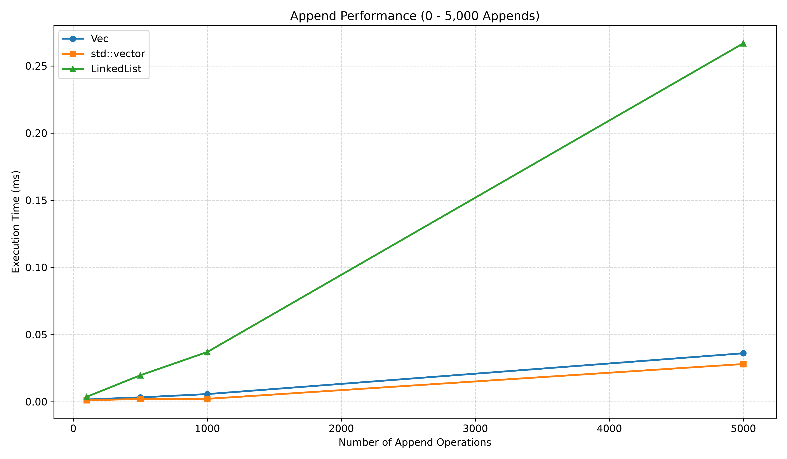
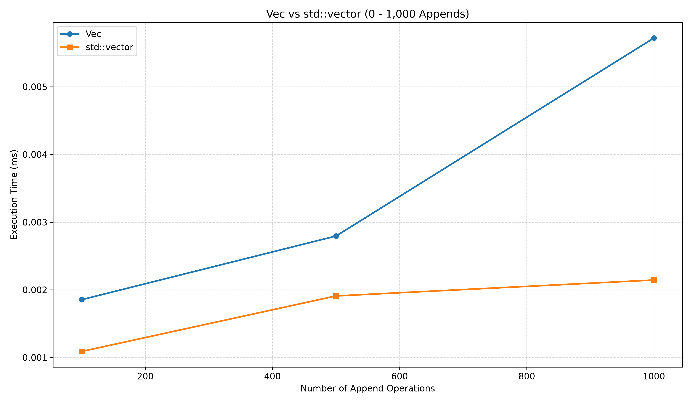
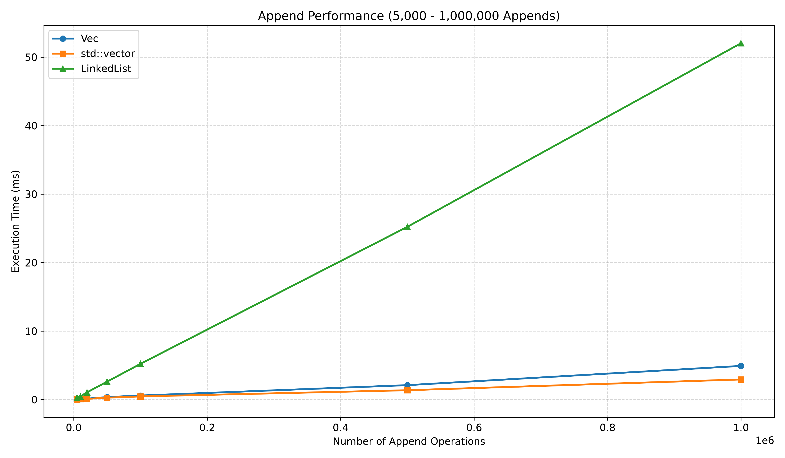
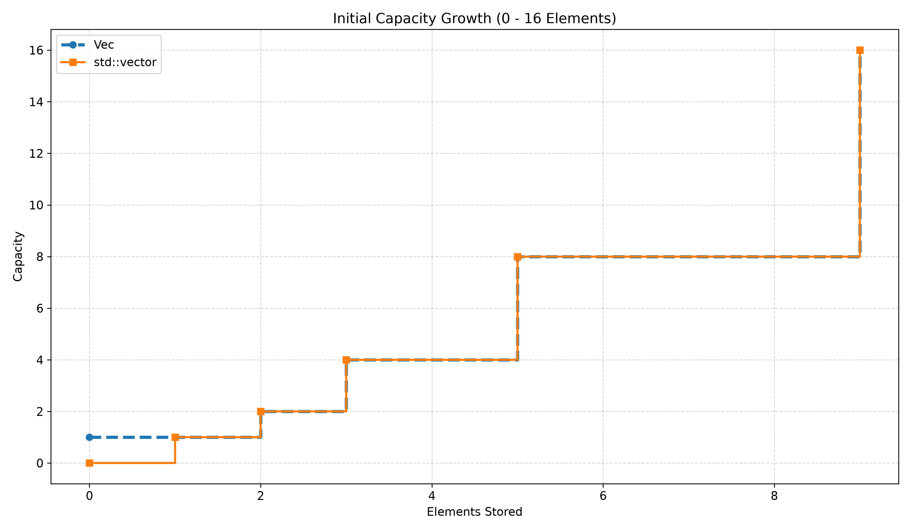

# Custom Linear Containers

[](https://github.com/roslindesiredziele-hash/Custom-Linear-Containers/actions/workflows/ci.yml)

A collection of custom linear data structures implemented in modern C++, accompanied by automated testing, continuous integration, and benchmark-driven performance analysis.

The project contains:

- **Vec** - a dynamic array inspired by `std::vector`
- **LinkedList** - a singly linked list implementation
- Comprehensive unit tests using **Catch2**
- Automated test execution with **CTest**
- Continuous integration through **GitHub Actions**
- Benchmarking and complexity analysis for append operations

---

## Table of Contents

- [Assignment Goals](#assignment-goals)
- [Implemented Containers](#implemented-containers)
  - [Vec](#vec)
  - [LinkedList](#linkedlist)
- [Complexity Analysis](#complexity-analysis)
  - [Vec Complexity](#vec-complexity)
  - [LinkedList Complexity](#linkedlist-complexity)
- [Project Structure](#project-structure)
- [Building](#building)
- [Testing](#testing)
- [Test Statistics](#test-statistics)
  - [Vec Test Coverage](#vec-test-coverage)
  - [LinkedList Test Coverage](#linkedlist-test-coverage)
  - [Overall Statistics](#overall-statistics)
- [Benchmarking](#benchmarking)
- [Benchmark Results](#benchmark-results)
  - [Append Performance (0 - 5,000 Appends)](#append-performance-0---5000-appends)
  - [Vec vs std::vector (0 - 1,000 Appends)](#vec-vs-stdvector-0---1000-appends)
  - [Append Performance (5,000 - 1,000,000 Appends)](#append-performance-5000---1000000-appends)
  - [Initial Capacity Growth (0 - 16 Elements)](#initial-capacity-growth-0---16-elements)
  - [Capacity Growth (16 - 524,289 Elements)](#capacity-growth-16---524289-elements)
  - [Numerical Results](#numerical-results)
  - [Observations](#observations)
- [Capacity Growth Analysis](#capacity-growth-analysis)
- [Design Highlights](#design-highlights)
  - [Table Doubling](#table-doubling)
  - [Rule of Five Support](#rule-of-five-support)
  - [Continuous Integration](#continuous-integration)
- [Technologies](#technologies)
- [Author](#author)

---

## Assignment Goals

This project was developed to explore:

- Dynamic memory management
- Resource ownership and RAII
- Copy and move semantics
- Iterator support
- Amortized complexity analysis
- Software testing practices
- Empirical performance evaluation

---

## Implemented Containers

### Vec

A dynamic array implementation inspired by `std::vector`.

Features:

- Automatic capacity growth
- Amortized O(1) append
- Deep copy semantics
- Move semantics
- Iterator support

### LinkedList

A singly linked list implementation.

Features:

- O(1) append
- Deep copy semantics
- Move semantics
- Dynamic node allocation
- Element insertion and deletion

---

## Complexity Analysis

### Vec Complexity

| Operation | Complexity |
|------------|------------|
| Access | O(1) |
| Append (amortized) | O(1) |
| Append (worst case) | O(n) |
| Resize | O(n) |
| Delete | O(n) |
| Linear Search | O(n) |
| Binary Search | O(log n) |

### LinkedList Complexity

| Operation | Complexity |
|------------|------------|
| Append | O(1) |
| Prepend | O(1) |
| Access by Index | O(n) |
| Search | O(n) |
| Delete | O(n) |

---

## Project Structure

```text
Vector
│
├── .github/
│   └── workflows/
│       └── ci.yml
│
├── external/
│   └── catch.hpp
│
├── src/
│   ├── Vec.cpp
│   └── Vec.h
│
├── linked_list/
│   ├── src/
│   │   ├── LinkedList.cpp
│   │   └── LinkedList.h
│   │
│   └── tests/
│       └── LinkedList_TDD.cpp
│
├── tests/
│   └── Vec_TDD.cpp
│
├── benchmarks/
│   ├── benchmark.cpp
│   ├── data/
│   └── report/
│
├── CMakeLists.txt
│
└── README.md
```

---

## Building

Configure the project:

```bash
cmake -S . -B build
```

Build the project:

```bash
cmake --build build
```

---

## Testing

Run all tests:

```bash
ctest --test-dir build -C Debug --output-on-failure
```

Run the test suites directly:

```bash
build/Debug/Vec_TDD.exe
```

```bash
build/Debug/LinkedList_TDD.exe
```

Expected outputs:

```text
All tests passed (91 assertions in 36 test cases)
```

```text
All tests passed (48 assertions in 17 test cases)
```

---

## Test Statistics

### Vec Test Coverage

- 36 test cases
- 91 assertions

### LinkedList Test Coverage

- 17 test cases
- 48 assertions

### Overall Statistics

- 53 test cases
- 139 assertions

---

## Benchmarking

The benchmark compares append performance of:

- `Vec`
- `std::vector`
- `LinkedList`

Benchmark source:

```text
benchmarks/benchmark.cpp
```

Generated benchmark data:

```text
benchmarks/data/
```

Generated figures:

```text
benchmarks/report/
```

---

## Benchmark Results

### Append Performance (0 - 5,000 Appends)



For small workloads, all three containers exhibit low execution times. Even at these scales, LinkedList begins to diverge from the vector-based containers.

---

### Vec vs std::vector (0 - 1,000 Appends)



A closer comparison reveals that the custom `Vec` implementation performs similarly to `std::vector`. The observed differences remain small throughout the measured range.

---

### Append Performance (5,000 - 1,000,000 Appends)



As the number of append operations increases, the performance gap becomes increasingly visible. Both vector-based containers scale efficiently while LinkedList becomes substantially slower.

---

### Initial Capacity Growth (0 - 16 Elements)



The only meaningful difference between the two vector implementations occurs during initialization. `Vec` begins with capacity one, whereas `std::vector` starts with capacity zero and allocates storage when the first element is inserted.

---

### Capacity Growth (16 - 524,289 Elements)


Beyond the initial allocation, both containers exhibit identical growth behaviour. Capacity doubles whenever the current storage becomes exhausted.

---

### Numerical Results

| Size | Vec (ms) | std::vector (ms) | LinkedList (ms) |
|------:|------:|------:|------:|
| 100 | 0.00169 | 0.00108 | 0.00364 |
| 500 | 0.00324 | 0.00205 | 0.01968 |
| 1,000 | 0.00569 | 0.00215 | 0.03701 |
| 5,000 | 0.03607 | 0.02806 | 0.26683 |
| 10,000 | 0.07055 | 0.05746 | 0.45885 |
| 20,000 | 0.13684 | 0.10774 | 1.06418 |
| 50,000 | 0.36705 | 0.27616 | 2.62000 |
| 100,000 | 0.59510 | 0.46443 | 5.21831 |
| 500,000 | 2.10927 | 1.36735 | 25.22770 |
| 1,000,000 | 4.91755 | 2.94202 | 52.03480 |

---

### Observations

#### Runtime Behaviour

| Container | Time for 1,000,000 Appends |
|------------|-----------:|
| std::vector | 2.94 ms |
| Vec | 4.92 ms |
| LinkedList | 52.03 ms |

The custom `Vec` implementation achieves performance comparable to `std::vector`. Although `std::vector` remains faster, the difference is relatively small compared to the dramatic gap between both vector-based containers and LinkedList.

#### LinkedList Performance

The linked list implementation performs significantly worse despite providing O(1) append complexity in theory.

Each append operation requires:

- Dynamic memory allocation
- Node construction
- Pointer manipulation

In contrast, `Vec` and `std::vector` store elements contiguously in memory, allowing significantly better cache utilization and reducing allocation frequency.

#### Reallocation Behaviour

The benchmark tracked container capacity during growth.

the behaviour of the standard library implementation. Capacity doubling explains why append operations maintain amortized O(1) complexity despite occasional expensive reallocations.

---

## Design Highlights

### Table Doubling

```cpp
if (len == cap)
{
    resize(2 * cap);
}
```

Capacity doubles whenever storage is exhausted.

### Rule of Five Support

The containers implement:

- Copy constructor
- Copy assignment
- Move constructor
- Move assignment
- Destructor

ensuring correct ownership and resource management.

### Continuous Integration

Every push is automatically verified through:

- GitHub Actions
- CMake
- CTest
- Catch2

All tests must pass before changes are considered valid.

---

## Technologies

- C++17
- CMake
- Catch2
- CTest
- GitHub Actions
- Python (benchmark visualization)

---

## Author

**Desire Roslin Dziele**  
Computer Science Student  
University of Łódź

> *Understanding how software works internally is the best way to build software that lasts.*