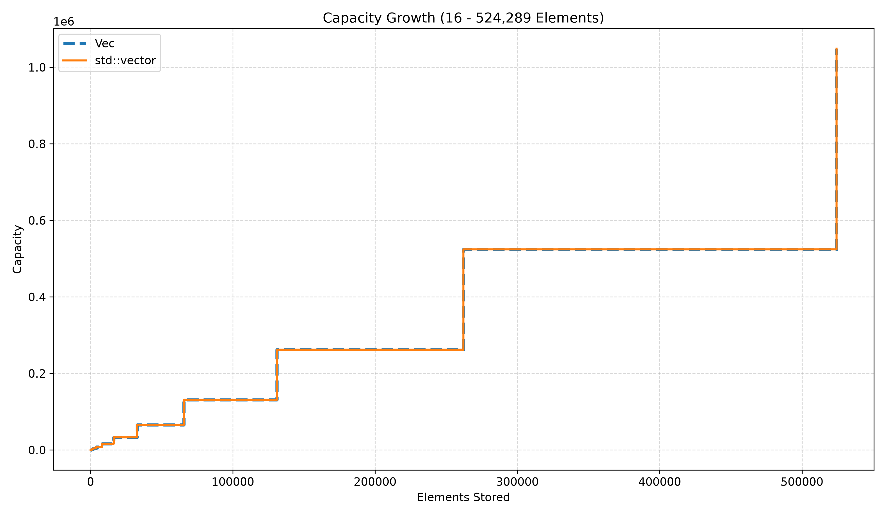

# Dangerous Minds – Custom Linear Containers

[](https://github.com/roslindesiredziele-hash/Custom-Linear-Containers/actions/workflows/ci.yml)

A collection of custom linear data structures implemented in modern C++, accompanied by automated testing, continuous integration, and benchmark-driven performance analysis.

This repository contains a complete solution to the **Dangerous Minds** assignment, including:

- **Vec** – a custom vector-like container implemented as a dynamically reallocated array using table doubling.
- **LinkedList** – a custom singly linked list implementation.
- Comprehensive unit tests using **Catch2**.
- Automated test execution using **CTest**.
- Continuous integration using **GitHub Actions**.
- Performance benchmarks comparing `Vec`, `std::vector`, and `LinkedList`.
- Capacity-growth experiments that make vector reallocations directly observable.

---

## Table of Contents

- [Assignment Goals](#assignment-goals)
- [Implemented Containers](#implemented-containers)
  - [Vec](#vec)
  - [LinkedList](#linkedlist)
- [Complexity Analysis](#complexity-analysis)
  - [Vec Complexity](#vec-complexity)
  - [LinkedList Complexity](#linkedlist-complexity)
- [Project Structure](#project-structure)
- [Building](#building)
- [Testing](#testing)
- [Test Statistics](#test-statistics)
  - [Vec Test Coverage](#vec-test-coverage)
  - [LinkedList Test Coverage](#linkedlist-test-coverage)
  - [Overall Statistics](#overall-statistics)
- [Benchmarking](#benchmarking)
- [Benchmark Results](#benchmark-results)
  - [Append Performance (0 - 5,000 Appends)](#append-performance-0---5000-appends)
  - [Vec vs std::vector (0 - 1,000 Appends)](#vec-vs-stdvector-0---1000-appends)
  - [Append Performance (5,000 - 1,000,000 Appends)](#append-performance-5000---1000000-appends)
  - [Initial Capacity Growth (0 - 16 Elements)](#initial-capacity-growth-0---16-elements)
  - [Capacity Growth (16 - 524,289 Elements)](#capacity-growth-16---524289-elements)
  - [Numerical Results](#numerical-results)
  - [Observations](#observations)
- [Capacity Growth Analysis](#capacity-growth-analysis)
- [Design Highlights](#design-highlights)
  - [Table Doubling](#table-doubling)
  - [Rule of Five Support](#rule-of-five-support)
  - [Continuous Integration](#continuous-integration)
- [Technologies](#technologies)
- [Author](#author)

---

## Assignment Goals

This project was developed as a solution to the **Dangerous Minds** assignment.

The assignment required:

- Implementing a custom vector-like container for integers.
- Using dynamic reallocation with table doubling.
- Providing read and write access to elements.
- Supporting appending, resizing and deletion operations.
- Measuring running times for large sequences of append operations.
- Comparing append performance against `std::vector`.
- Comparing append performance against a custom linked list.
- Investigating when reallocations occur.
- Demonstrating amortized O(1) append complexity.

To satisfy these requirements, the project contains a custom dynamic array implementation (`Vec`), a custom singly linked list implementation (`LinkedList`), automated tests and a benchmark suite.

---

## Implemented Containers

### Vec

`Vec` is a dynamic array implementation inspired by `std::vector`.

The container stores integers in contiguous memory and automatically grows using table doubling.

Implemented functionality:

- Element access through `operator[]`
- Element access through `get()`
- `first()` and `last()`
- `push()`
- `pop()`
- `resize()` (supports growth and truncation when downsizing)
- `deleteMe()` for deletion of a single element
- `deleteUs()` for deletion of a range of elements
- `linearSearch()`
- `binarySearch()`
- `reverse()`
- `rotate()`
- Iterator support

The container doubles its capacity whenever the current storage becomes full, providing amortized **O(1)** append operations.

### LinkedList

A custom singly linked list implementation.

Features include:

- O(1) append
- O(1) prepend
- Dynamic node allocation
- Deep copy semantics
- Move semantics
- Element insertion
- Element deletion
- Search functionality

---

## Complexity Analysis

### Vec Complexity

| Operation | Complexity |
|------------|------------|
| Access | O(1) |
| Append (amortized) | O(1) |
| Append (worst case) | O(n) |
| Resize | O(n) |
| Delete | O(n) |
| Linear Search | O(n) |
| Binary Search | O(log n) |

### LinkedList Complexity

| Operation | Complexity |
|------------|------------|
| Append | O(1) |
| Prepend | O(1) |
| Access by Index | O(n) |
| Search | O(n) |
| Delete | O(n) |

---

## Project Structure

```text
Vector
│
├── .github/
│   └── workflows/
│       └── ci.yml
│
├── external/
│   └── catch.hpp
│
├── src/
│   ├── Vec.cpp
│   └── Vec.h
│
├── linked_list/
│   ├── src/
│   │   ├── LinkedList.cpp
│   │   └── LinkedList.h
│   │
│   └── tests/
│       └── LinkedList_TDD.cpp
│
├── tests/
│   └── Vec_TDD.cpp
│
├── benchmarks/
│   ├── benchmark.cpp
│   ├── data/
│   └── report/
│
├── CMakeLists.txt
│
└── README.md
```

---

## Building

Configure the project:

```bash
cmake -S . -B build
```

Build the project:

```bash
cmake --build build
```

---

## Testing

Run all tests:

```bash
ctest --test-dir build -C Debug --output-on-failure
```

Run the test suites directly:

```bash
build/Debug/Vec_TDD.exe
```

```bash
build/Debug/LinkedList_TDD.exe
```

Expected outputs:

```text
All tests passed (91 assertions in 36 test cases)
```

```text
All tests passed (48 assertions in 17 test cases)
```

---

## Test Statistics

### Vec Test Coverage

- 36 test cases
- 91 assertions

### LinkedList Test Coverage

- 17 test cases
- 48 assertions

### Overall Statistics

- 53 test cases
- 139 assertions

---

## Benchmarking

The benchmark compares append performance of:

- `Vec`
- `std::vector`
- `LinkedList`

Benchmark source:

```text
benchmarks/benchmark.cpp
```

Generated benchmark data:

```text
benchmarks/data/
```

Generated figures:

```text
benchmarks/report/
```

---

## Benchmark Results

### Append Performance (0 - 5,000 Appends)


For small workloads, all three containers complete their work quickly. Even at these scales, LinkedList already begins to diverge from the vector-based containers.

Although append operations are theoretically O(1) for all three structures, LinkedList performs a dynamic memory allocation for every inserted element. In contrast, Vec and std::vector reuse contiguous memory that was allocated during previous growth operations.

The graph demonstrates that the custom Vec follows the performance characteristics of std::vector from the beginning of execution.

---

### Vec vs std::vector (0 - 1,000 Appends)


This graph isolates the two vector implementations.

The custom Vec implementation remains consistently close to std::vector. The small performance gap is likely caused by implementation details and compiler optimizations rather than differences in algorithmic behaviour.

The similarity of the curves demonstrates that both containers rely on the same underlying strategy: contiguous storage combined with geometric growth.

---

### Append Performance (5,000 - 1,000,000 Appends)


As input sizes increase, the performance characteristics become significantly more apparent.

Both Vec and std::vector scale efficiently and remain within only a few milliseconds even for one million append operations. LinkedList becomes substantially slower because every insertion requires node allocation and pointer manipulation.

At one million append operations:

- `std::vector` required approximately **2.94 ms**
- `Vec` required approximately **4.92 ms**
- `LinkedList` required approximately **52.03 ms**

The experiment demonstrates that contiguous storage is substantially more efficient than repeated node allocation for this workload.

---

### Initial Capacity Growth (0 - 16 Elements)


The benchmark records capacity whenever a reallocation occurs.

The only observable difference between the vector implementations occurs during initialization:

- `std::vector` begins with capacity 0.
- `Vec` begins with capacity 1.

After the first insertion both containers quickly converge to the same growth strategy.

---

### Capacity Growth (16 - 524,289 Elements)



This graph makes reallocation events directly visible.

Both implementations exhibit identical capacity growth:

```text
1 → 2 → 4 → 8 → 16 → 32 → 64 → ...
```

Reallocations occur whenever available storage becomes exhausted. The benchmark recorded reallocation points at:

```text
2, 3, 5, 9, 17, 33, 65, 129, ...
```

for both implementations.

The overlap of thes performance comparable to std::vector. Although std::vector remains faster, the difference is relatively small compared to the dramatic gap between both vector-based containers and LinkedList.

#### LinkedList Performance

The linked list implementation performs significantly worse despite offering O(1) append complexity in theory.

Each append operation requires:

- Dynamic memory allocation
- Node construction
- Pointer manipulation

In contrast, Vec and std::vector store elements contiguously in memory, allowing much more effective cache utilization and reducing allocation frequency.

#### Reallocation Behaviour

The capacity-growth benchmark makes reallocation events directly observable.

Whenever capacity is exhausted:

1. A larger memory block is allocated.
2. Existing elements are copied into the new block.
3. The old memory block is released.

These reallocation events correspond directly to the visible jumps in the capacity graphs.

Both Vec and std::vector followed exactly the same reallocation schedule throughout the experiment.

#### Amortized O(1) Append

Individual append operations occasionally incur O(n) cost because reallocation requires copying existing elements into a larger array.

However, capacity doubles whenever growth occurs:

```text
1 → 2 → 4 → 8 → 16 → 32 → ...
```

As a result, the number of reallocations grows only logarithmically relative to the number of inserted elements.

The measured runtime curves and capacity-growth graphs provide empirical evidence that append operations exhibit:

```text
O(1) amortized
```

complexity for both Vec and std::vector.

---

## Capacity Growth Analysis

The measured capacity data shows that both Vec and std::vector used the same table-doubling strategy.

The only difference occurred during initialization:

```text
Vec         : starts with capacity 1
std::vector : starts with capacity 0
```

Afterward both containers followed identical growth behaviour:

```text
1 → 2 → 4 → 8 → 16 → 32 → ...
```

This observation directly explains the measured append performance and confirms the theoretical expectation of amortized O(1) insertion.

---

## Design Highlights

### Table Doubling

```cpp
if (len == cap)
{
    resize(2 * cap);
}
```

Capacity doubles whenever storage becomes exhausted.

### Rule of Five Support

The containers implement:

- Copy constructor
- Copy assignment
- Move constructor
- Move assignment
- Destructor

ensuring proper resource ownership and memory safety.

### Continuous Integration

Every push is automatically verified through:

- GitHub Actions
- CMake
- CTest
- Catch2

All tests must pass before changes are considered valid.

---

## Technologies

- C++17
- CMake
- Catch2
- CTest
- GitHub Actions
- Python (benchmark visualization)

---

## Author

**Desire Roslin Dziele**  
Computer Science Student  
University of Łódź

> *Understanding how software works internally is the best way to build software that lasts.*